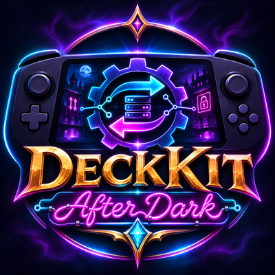

<p align="center"></p>

# DeckKitAfterDark

A companion suite to [DeckKit](https://github.com/fillmoreb/DeckKit) (controller-first addons for WoW:
Forever on the Steam Deck) for addons in the **ToS gray area**: programs on the Deck exchanging data
with the game while you play. They're kept out of DeckKit on purpose. Nothing here plays for you, but
it does let outside programs feed addons and read what addons show. Install at your own judgment.

Every addon here needs the DeckKit core (`## Dependencies: DeckKit`).

**Installing:** see [INSTALL.md](INSTALL.md).

| Addon | What it does |
|---|---|
| **DeckLink** | A two-way data link between a program on the Deck and addons: key taps in, colored cells on screen out. `/deckkit link` shows how it's going. |
| **DeckDictation** | Decktation's exact state (recording, transcribing, done, error) for DeckKit's dictation indicator, from Decktation's status hook (`deck-setup/decktation-hook.sh`, installed as `decklink-decktation-hook`). |
| **DeckTelemetry** | The Deck's battery, charging, power, temperatures, fan and CPU/GPU/memory load, for other addons to show (it draws nothing itself). `/deckkit telemetry` prints the latest. |
| **DeckAgent** | The game side of DeckAgent, a gaming assistant you ask things by voice ("give me a waypoint to the nearest priest trainer"). Through a fixed list of requests it reads where you are, your target, quest log, character, bags and prices and who's online; sets and removes waypoints (through WayPad); sends chat for you (or previews it for your A press); asks you with a prompt; shows its answers on a card, a reading view or a self-ticking checklist; flags items in your bags (PackPad); and keeps hooks that tell it when something happens. `/deckkit agent`. See [DeckAgent](#deckagent). |

## DeckLink

**In:** the program taps **F9** (a 0) and **F10** (a 1), one bit per tap. DeckLink's override bindings
catch them: nothing is typed, nothing needs focus, nothing is saved to your keybinds. The game queues
every tap (AddonTools lab/RESULTS.md E6), but handling key input costs it ~0.17 ms per press or
release, so a burst freezes it (1 KB ≈ 2.7 s). Taps are paced 1 ms apart instead: no visible cost,
about 450 bits (55 bytes) a second. Never two keys down at once: the
game loses the first key's release then.

**Out:** while a program has the link open, a row of 4 px colored cells runs along the bottom edge
of the screen (it's gone otherwise; the cover below hides it from you). The program reads it from gamescope's video stream: whether the
game is ready for keys (no chat box open), which frame arrived last, and one frame from the game.

**Bigger frames by paste:** frames of 40 bytes or more go through the clipboard instead, when a
clipboard tool is there (`xclip`; Decktation ships one). A PASTE control frame, sent by keys, has
DeckLink focus a hidden edit box. The program presses Ctrl+V, and the box checks the one-line paste:
`DLP1 <seq> <channel> <length> <crc> <base64>`. It then delivers the frame as if it came by keys and
gives focus back at once (or after 3 s if nothing comes). About 0.3 s whatever the size. Your
clipboard is put back afterwards, and if a paste fails, the frame goes by keys (up to 500 bytes: a bigger
one would take longer than the game keeps the link open, so it isn't sent).

**Frames** both ways: `len (2) | channel (1) | seq (1) | payload | CRC-16 (2)`. Stop-and-wait: the
program waits until the strip shows its frame's seq (resending if not), and acks each frame the game
shows. A lost or extra tap fails the CRC: that frame is dropped and counted, never delivered wrong. A
frame keeps its seq when it's sent again, by paste or by keys, and the game runs a seq once per channel
(it forgets them at a hello, or after 30 s without that channel), so a frame that arrived while its ack
went unseen is acked again, never run twice.
Channel 0 is the link's own (hello, ack, bye, ping); addons use 1-255:

```lua
DeckLink.On(5, function(payload, seq) ... end)   -- frames from the program on channel 5 (seq: the frame's)
DeckLink.Send(5, "text")                     -- false if the link is closed or it's too long
DeckLink.MaxPayload()                        -- about 545 bytes (one strip row); inbound up to 4096
```

The program's side is `deck-setup/decklink` (Python 3, standard library + the Deck's GStreamer):

```
decklink status                  the strip as it is now
decklink ping [--size N]         open the link and time a round trip
decklink send CHANNEL [TEXT]     send TEXT (or stdin) to an addon's channel
decklink recv [--count N]        print what the game sends
```

```python
from decklink.link import Link
with Link() as link:
    link.send(5, b"hello")
    print(link.recv(timeout=5))
```

Keys go in through Decktation's ydotool daemon when the program runs as root, else xdotool on
Xwayland `:1` as the desktop user. Reading the strip needs Game Mode (gamescope's PipeWire stream).

Installing it on the Deck (on the Deck itself, or over SSH from a Mac or Linux computer), the services it
runs, and Decktation's status hook: [INSTALL.md](INSTALL.md).

## DeckTelemetry

`python3 -m decklink.telemetry` (on the Deck; `--every 5`, `--once`, `--print`) sends one 17-byte binary
frame on channel 1 every few seconds (fields at fixed places, layout in `telemetry.py`): fire and
forget, no strip, no screen reading, so it costs next to nothing. A lost update (chat was open) is
just replaced by the next. It waits while another program has the link open or a dictation is under
way, so its taps never delay a question or the dictation indicator. In the game:

```lua
local t = DeckTelemetry.Get()          -- nil before the first update; t.age = seconds since it
-- t.bat %, t.st "charging"/"discharging"/"not charging"/"full", t.ac boolean, t.bw W (+ draining),
-- t.apu W, t.cpu %, t.gpu %, t.mem %, t.tapu / t.tbat / t.tssd C, t.fan rpm
DeckTelemetry.OnUpdate(function(t) ... end)   -- after each update; returns a handle for Cancel
DeckTelemetry.Age()                     -- seconds since the last update: tells fresh from stale
```

## DeckAgent

A gaming assistant, the way Claude Code is a coding assistant: you ask (by voice, on the Deck), it looks
things up and acts in the game through a short, fixed list of requests, and answers out loud and on
screen. It calls itself Decky. A `codex exec` engine and addon installs are planned.

```
deckagent "give me a waypoint to the nearest priest trainer"
# -> I set a waypoint to X'yera, a priest trainer in Orgrimmar about 202 yards away.
```

- **Asking:** hold the agent binding (L5+R5 in Ben's setup: Decktation's agent binding, a DeckKit
  fork of Decktation) and speak. The transcript goes to the link keeper (`decklink-agent-ask`), which
  runs `deckagent`, speaks the answer with Piper and echoes it into chat (`deck-setup/decklink/voice.py`).
  Asking again cuts the answer off and drops a question still being worked on, with what it asked the
  game for and hasn't got (a prompt up for it is taken down). With Quiet on (DeckKit
  menu, Tools › DeckAgent) answers are only shown. `deckagent "…"` also works from a terminal.
- **The brain** is `claude -p` (Claude Code, signed in with your own Claude plan, so it draws on your
  plan's limits, not an API bill; Sonnet unless the game's menu picks Haiku or Opus), run from the
  agent's own folder (`~/.deckagent`) with `--strict-mcp-config`. Its built-in tools are web search and
  fetch, and Read, Edit and Write inside its own folder only (its notes); everything else is denied.
- **The only way into the game** is `agent/mcp_server.py` (MCP, standard library only). Its tools:
  - where Ben is and what he has: `get_player_state` (position, zone, faction, level, class, combat,
    target), `get_character`, `get_bags`, `get_item_info`, `get_prices` (DeckKit's MarketDeck),
    `get_quests` (his quest log, named from the database), `get_online` (friends and guild)
  - the database alone, never the game: `find_npc` (nearest first, by role or name), `find_quests`
    (with his status from the game), `find_items`
  - doing things: `set_waypoint`, `get_waypoints`, `remove_waypoints`, `send_chat`, `ask_player` (a
    prompt he answers with the pad), `flag_items` / `clear_flags` (PackPad's star),
    `track_checklist` / `clear_checklist`
  - hooks ("tell me when…"): `set_hook`, `list_hooks`, `remove_hook`
  - memory: `remember` (People and Ben's rules in its notes), `remember_fact`, `recall`, `forget_fact`
  - `respond`: always last, the answer: what's spoken (160 characters at most) and the one display that
    fits (none, a text card, a list, a checklist or a reading view)

  The launcher (`agent/deckagent`) allows exactly these. They reach the game with `decklink agent …`
  (`deck-setup/decklink/agent.py`, DeckLink channel 3), answered by the DeckAgent addon. There is no
  way to run Lua, send slash commands, or touch combat, movement, targeting or casting.
- **Packets** are binary, with fields at fixed places, because keys into the game carry only about 55
  bytes a second: asking for your location is 2 bytes (op byte, field mask), 64 key taps; a waypoint
  is 7 bytes (op byte, map, x, y); big ones (a checklist, a reading view) go by paste. The reply comes
  back on the strip: status, then the op's fields. Each op's layout is in the header of the file that
  answers it; `deck-setup/decklink/agent.py` builds and reads them all:

  | Ops | Layout in |
  |---|---|
  | the packet and reply framing, STATE (1), WAY (2), WAYPOINTS (10) | `addons/DeckAgent/Agent.lua` |
  | CHAT (3), FRIENDS (4) | `addons/DeckAgent/Chat.lua` |
  | ASK (5), ANSWER (6), DISMISS (19) | `addons/DeckAgent/Ask.lua` |
  | SHOW (7: echo, card, reading view) | `addons/DeckAgent/Show.lua` |
  | QUESTS (8), QUEST_STATUS (9) | `addons/DeckAgent/Quests.lua` |
  | CHECKLIST (11) | `addons/DeckAgent/Checklist.lua` (its conditions: `Conditions.lua`) |
  | HOOKS (12), EVENTS (13) | `addons/DeckAgent/Hooks.lua` |
  | CHARACTER (14), BAGS (15), ITEM_INFO (16), PRICES (17), MARKS (18) | `addons/DeckAgent/Inventory.lua` |

  `addons/DeckAgent/Bytes.lua` packs and reads the numbers for all of them.
- **The link keeper** (`decklink.agentd`, the `decklink-agent` user service) holds DeckLink open for
  the assistant and answers voice questions:
  - it opens on the first request and closes after 25 s idle; while it's closed the screen isn't read,
    except that while a hook is set it glances at the strip about once a second (one paused capture,
    ~2% of a core) for DeckAgent's attention flag
  - `decklink agent …` goes through it over a local socket
  - a request then takes about 0.6 s on the Deck, against about 4.4 s when each call opened the link
  - the launcher fetches your position, faction, target and settings before asking, so "nearest X"
    skips a model turn
- **Hooks**: the game keeps only a hook's condition (a quest taken or done, an objective, an item
  count, a level, a zone, XP), as numbers; the keeper keeps Decky's note for it and timers
  (`~/.deckagent/hooks.json`). When one fires, the note is spoken as a reminder or Decky is woken with it.
- **Memory**: her notes (`~/.deckagent/CLAUDE.md`: People and Ben's rules), facts in
  `~/.deckagent/memory.db` (the launcher brings related ones with each question) and every character
  seen online. Questions close together continue one conversation.
- **The database** (`~/.deckagent/deckagent.db`, SQLite) is built by `python3 -m agent.update_data`. It
  draws on QuestieDB's Forever NPCs, quests, items and objects (spawn coordinates converted for 1.60) and
  wago.tools' Forever map tables. Those are downloaded to `~/.deckagent/data`, never committed: they
  aren't ours to redistribute.
- **On the Deck** (the usual way): [INSTALL.md](INSTALL.md) installs it all, including a daily
  database update. Then, as deck: `claude auth login` (once), and `deckagent "…"` or the agent binding.
- **Setup on a Mac** (the brain on the Mac, the game on the Deck; each game call adds ~2 s of SSH): install Claude Code and sign in, then
  set `DECKAGENT_DECK=claude@<deck>` (an SSH target that can `sudo -u deck`; `DECK` in deploy.local works too) and run
  `python3 -m agent.update_data`. On the Deck itself, leave `DECKAGENT_DECK` unset.

## Keys (Ben's setup)

Every key the setup binds, across DeckKit, DeckKitAfterDark, Decktation and the dev tools:

| Key | Sent by | Does |
|---|---|---|
| F1 / F2 / F3 / F4 | the Steam layout, while grip L4 / R4 / L5 / R5 is held | DeckKit grip chords |
| F5 / F6 / F7 / F8 | the Steam layout, once L4 / R4 / L5 / R5 has been held 0.4 s | DeckKit grip chord holds |
| F9 / F10 | a DeckLink program (ydotool or xdotool) | DeckLink bits 0 / 1 (free without DeckLink) |
| F11, F12 | | spare |
| Ctrl+Shift+F1-F5, F11, F12 | `deckctl` (AddonTools, dev only, while DeckDev is installed) | receive, commit, cancel, export, load inbox slot, strip on, reload |

Reload UI has no key: it's on a grip slot. Decktation reads the controller directly and types its text
with ydotool; its status hook goes through DeckLink (F9/F10, channel 2), so it needs no keys of its own.

DeckLink channels, all binary with fields at fixed places (keys into the game carry only ~55 bytes a
second, so every byte counts):

| Channel | What | Size | Layout |
|---|---|---|---|
| 0 | the link's own (hello, ack, bye, ping) | 1-2 bytes | `codec.py` |
| 1 | Deck telemetry (DeckTelemetry) | 17 bytes | `telemetry.py` |
| 2 | dictation state + which binding (DeckDictation) | 2 bytes | `dictation.py` |
| 3 | DeckAgent's requests and replies | 1 byte to 4 KB in (paste from 40 bytes) | `addons/DeckAgent/Agent.lua` and the op files ([DeckAgent](#deckagent)) |

## The cover

`decklink.cover` hides the strip from you: a black bar over the bottom 4 px, drawn as a gamescope
overlay (the way MangoHud's is), shown only while the link is open. You see black; the program reading
the strip doesn't, because gamescope's video stream leaves overlays out (AddonTools lab E7). It takes
no input and never takes focus. Run it as the desktop user in Game Mode:
`DISPLAY=:0 PYTHONPATH=~/.local/lib python3 -m decklink.cover` (`--color ffff00` to see where it is,
`--always` to keep it up). Hosts mark the link open in `/tmp/decklink-open`; the cover checks that file,
so it costs next to nothing.

## Development

- `./deploy.sh DeckLink` deploys through AddonTools' `deckctl` (like DeckKit's), `deploy.local` as there.
- `test/run.sh` runs the tests: the Python host side against the real addon code, through
  `test/harness.lua` (a stub WoW API; needs `lua5.1`).

## License

MIT, see [`LICENSE`](LICENSE). The logo in `media/` is AI-generated and not covered by the MIT License.
DeckKitAfterDark is an unofficial fan project, not affiliated with Blizzard Entertainment.
